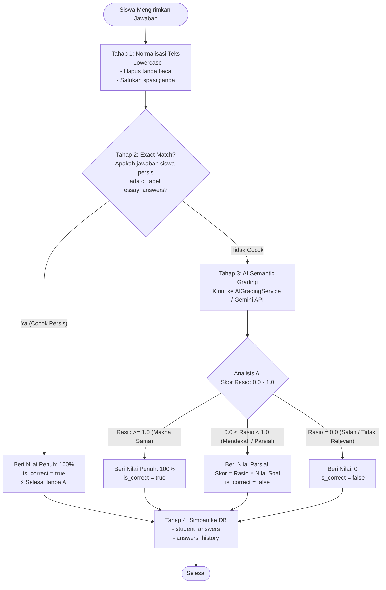

# Panduan Pembuatan Soal Essay & Tebak Gambar, Kunci Jawaban, Flow Pengecekan, dan Cara Kerja AI Grading

Dokumen ini menjelaskan secara menyeluruh dan mudah dipahami bagaimana sistem kuis **ReadNRead (Sinaumatika)** menangani soal bertipe **Essay** dan **Tebak Gambar (`guess_image`)**, mulai dari pembuatan soal, penyimpanan kunci jawaban, alur verifikasi jawaban siswa, hingga kecerdasan buatan (**AIGradingService**) menilai jawaban siswa secara semantik.

---

## 1. Pembuatan Soal Essay dan Tebak Gambar

Pada backend sistem ini, baik soal **Essay** maupun **Tebak Gambar** dikelola melalui endpoint pembuatan soal (`QuestionApiController` & `QuestionRepository`).

### A. Perbedaan Mendasar Kedua Tipe Soal

| Fitur | Soal Essay (`essay`) | Soal Tebak Gambar (`guess_image`) |
| :--- | :--- | :--- |
| **Bentuk Pertanyaan** | Berupa teks pertanyaan tertulis. | Berupa **gambar** yang wajib ditampilkan kepada siswa (bisa ditambah petunjuk teks). |
| **Upload Gambar Soal** | Opsional / Tidak wajib. | **Wajib** (`question_image` berupa file gambar max 2MB). |
| **Cara Siswa Menjawab** | Mengetikkan jawaban teks. | Mengetikkan jawaban teks berdasarkan gambar yang dilihat. |
| **Kunci Jawaban** | Disimpan di tabel `essay_answers`. | Disimpan di tabel `essay_answers`. |

---

### B. Cara Membuat Soal (Request API)

Endpoint pembuatan soal:
```http
POST /api/admin/questions
Content-Type: multipart/form-data
Authorization: Bearer {token}
```

> **Catatan:** Karena tipe `guess_image` memerlukan pengunggahan file gambar, request selalu menggunakan format `multipart/form-data`.

#### Contoh Payload Soal Essay:
```
quiz_id        : 1
type           : essay
question_text  : Berapa hasil penjumlahan dari lima ditambah dua?
order          : 1
score          : 10
option_text    : 7|tujuh|tuju
```

#### Contoh Payload Soal Tebak Gambar:
```
quiz_id        : 1
type           : guess_image
question_text  : Hewan apakah yang ada pada gambar di atas? (opsional)
question_image : [File: kucing_lucu.png]
order          : 2
score          : 15
option_text    : kucing|kuceng|anak kucing|cat
```

---

## 2. Kunci Jawaban: Konsep dan Penyimpanan

Dalam soal isian atau tebak kata untuk anak-anak, satu pertanyaan sering kali memiliki **lebih dari satu jawaban yang benar** (variasi sebutan, bahasa, atau sinonim).

### A. Format Input Kunci Jawaban (`|`)
Guru atau pembuat soal dapat memasukkan beberapa alternatif kunci jawaban sekaligus pada parameter `option_text` dengan memisahkannya menggunakan karakter pipa vertikal (`|`).

Contoh:
```
kucing|kuceng|meong|anak kucing
```

### B. Proses Penyimpanan di Database
Ketika request diterima oleh `QuestionRepository`:
1. Sistem memecah teks berdasarkan tanda `|` (`explode('|', $option_text)`).
2. Setiap jawaban dibersihkan dari spasi kosong di ujung (`trim`).
3. Seluruh karakter diubah menjadi huruf kecil (`strtolower`).
4. Setiap alternatif jawaban disimpan sebagai satu baris record di tabel `essay_answers` dengan relasi `question_id`.

```
[Tabel: questions]
id: 10
type: guess_image
question_image: storage/questionsImage/question_image_xxx.png
score: 15
   │
   └── Relasi (hasMany) ──► [Tabel: essay_answers]
                             ├── ID: 101 | question_id: 10 | option_text: "kucing"
                             ├── ID: 102 | question_id: 10 | option_text: "kuceng"
                             └── ID: 103 | question_id: 10 | option_text: "meong"
```

---

## 3. Alur (Flow) Pengecekan Jawaban Siswa

Pemeriksaan jawaban siswa dirancang dengan pendekatan **2 Tingkat (2-Tier Grading)** agar sistem bekerja **sangat cepat**, **hemat kuota API AI**, namun tetap **pintar dan adil** untuk anak-anak.

### Diagram Alur Penilaian



---

### Penjelasan Langkah Demi Langkah

#### Langkah 1: Normalisasi Teks (Pembersihan Awal)
Sebelum dibandingkan, teks jawaban siswa dan kunci jawaban diseragamkan lewat fungsi `normalizeAnswerText()`:
- Menghapus spasi di awal/akhir (`trim`).
- Mengubah ke huruf kecil semua (`strtolower`).
- Menghapus seluruh tanda baca (`.,!?-_`) menggunakan Regular Expression `preg_replace('/[^\p{L}\p{N}\s]/u', '', $text)`.
- Menyederhanakan beberapa spasi berurutan menjadi satu spasi saja.

> **Contoh:** Jawaban `"  Kucing!!  "` dinormalisasi menjadi `"kucing"`.

#### Langkah 2: Pengecekan Eksak (Exact Match)
- Sistem memeriksa apakah hasil normalisasi ada di dalam daftar kunci jawaban (`in_array`).
- **Jika COCOK**: Siswa langsung mendapat nilai penuh 100% dari bobot soal (`score`), dan `is_correct = true`.
- **Keuntungan**: Sangat cepat (0 milidetik latensi AI) dan 100% gratis tanpa konsumsi kuota API Google.

#### Langkah 3: Pengecekan AI (Fallback Semantic AI Grading)
- Jika **TIDAK COCOK secara eksak**, sistem tidak langsung menyalahkan jawaban siswa.
- Mengapa? Karena anak SD sering kali:
  - Salah ketik satu atau dua huruf (contoh: `"kucing"` diketik `"kucng"` atau `"kuceng"`).
  - Menggunakan sinonim (contoh: kunci `"berlari"`, anak menjawab `"lari"`).
  - Menulis angka dengan kata atau sebaliknya (contoh: kunci `"67"`, anak menjawab `"enam puluh tujuh"`).
  - Menggunakan kalimat penjelas (contoh: `"hewan kucing rumahan"`).
- Pada saat inilah backend memanggil **`AIGradingService`** untuk menilai kesamaan makna.

---

## 4. Bagaimana AIGradingService Bekerja?

`AIGradingService` adalah jembatan penghubung backend Laravel dengan model kecerdasan buatan **Google Gemini** (`gemini-3.1-flash-lite`).

### A. Arsitektur Layanan

```
Laravel Backend (UserAnswerRepository)
        │
        ▼ (Mengirimkan: Jawaban Siswa, Kunci Jawaban, Teks Soal, Tipe Soal)
  AIGradingService
        │
        ▼ (Membangun System Prompt Khusus Pembelajaran Anak SD)
  Google Gemini API (gemini-3.1-flash-lite)
        │
        ▼ (Menghasilkan respons teks berupa angka: "100", "50", atau "0")
  Pembersihan & Parsing Nilai (Regex & Clamping 0-100)
        │
        ▼ (Konversi ke Rasio Float: 1.0, 0.5, 0.0)
Kembali ke Repository untuk Kalkulasi Nilai Akhir
```

---

### B. Prompt Engineering yang Digunakan

`AIGradingService` menyusun instruksi terarah (*prompt engineering*) yang dirancang khusus untuk konteks **aplikasi belajar anak sekolah dasar**:

1. **Peran AI**: Bertindak sebagai sistem penilai otomatis untuk aplikasi membaca/belajar anak SD.
2. **Konteks Diberikan**:
   - Kalimat pertanyaan soal.
   - Daftar semua alternatif kunci jawaban yang sah.
   - Jawaban yang diketik oleh siswa.
3. **Instruksi Toleransi Khusus**:
   - **Toleransi Ejaan**: Typo ringan 1-2 huruf tetap dimaklumi (misal: `"tuju"` dianggap sama dengan `"tujuh"`).
   - **Angka vs Teks**: Digit angka dan ejaannya dianggap setara (misal: `"67"` = `"enam puluh tujuh"`).
   - **Kapitalisasi & Spasi**: Huruf besar/kecil dan spasi berlebih tidak boleh mengurangi nilai.
   - **Substansi / Makna**: Yang dinilai adalah inti makna, bukan kecocokan kata per kata.
4. **Skala Penilaian**:
   - **100**: Inti makna sama (sinonim, variasi kata wajar, typo ringan).
   - **50**: Jawaban mendekati atau masih relevan, tapi belum sempurna (misal: kunci `"kucing"`, anak menjawab `"hewan berbulu"`).
   - **0**: Jawaban salah atau tidak relevan sama sekali.
   - Nilai fleksibel (seperti 70, 80, 30) juga diizinkan jika relevansi berada di antaranya.
5. **Format Keluaran Ketat**: AI diwajibkan **hanya merespons dengan angka** (tanpa kata tambahan, tanpa penjelasan) dengan batas maksimum token = 10 dan `temperature` = 0.1 agar jawaban konsisten dan tidak berhalusinasi.

---

### C. Pemrosesan Hasil Nilai AI

1. Respons mentah dari Gemini disaring hanya karakternya yang berupa angka:
   ```php
   $cleaned = trim(preg_replace('/[^0-9]/', '', $rawText));
   $score   = is_numeric($cleaned) ? (int) $cleaned : 0;
   ```
2. Nilai dibatasi secara aman antara `0` hingga `100` (`max(0, min(100, $score))`).
3. Nilai dikonversi menjadi rasio pecahan antara `0.0` sampai `1.0`:
   ```php
   $ratio = $score / 100.0;
   ```
4. **Pemberian Skor ke Siswa di Repository**:
   - Jika `ratio >= 1.0`: Siswa memperoleh nilai penuh (`$question->score`), `is_correct = true`.
   - Jika `ratio > 0.0` (misal 0.5 atau 0.8): Siswa memperoleh nilai parsial (`round($ratio * $question->score, 2)`), `is_correct = false`.
   - Jika `ratio == 0.0`: Siswa memperoleh nilai `0`, `is_correct = false`.

---

### D. Mekanisme Keamanan (Fail-Safe & Fallback)

Sistem telah dirancang agar tidak mengalami *crash* atau *error 500* jika terjadi gangguan jaringan ke server Google:
- **API Key Belum Ada**: Jika `GEMINI_API_KEY` belum disetel di `.env`, AI grading otomatis dilewati dan mengembalikan nilai `0.0`.
- **Koneksi Timeout / Gagal**: Menggunakan batas waktu koneksi (`Http::timeout(10)`). Jika terjadi error jaringan atau kuota habis, ditangkap oleh blok `catch (\Exception $e)`, dicatat di file log Laravel (`laravel.log`), dan mengembalikan nilai `0.0` secara aman.

---

## 5. Simulasi Contoh Kasus Riil

Berikut adalah beberapa contoh bagaimana sistem menilai berbagai jawaban siswa:

| Soal & Kunci Jawaban | Jawaban Siswa | Tahap Penilaian | Keputusan AI / Sistem | Hasil Akhir |
| :--- | :--- | :--- | :--- | :--- |
| **Kunci:** `kucing` | `"kucing"` | Exact Match | Cocok persis (tanpa panggil AI) | **Nilai 100% (Penuh)** |
| **Kunci:** `kucing` | `"KUCING!! "` | Exact Match | Setelah normalisasi tanda baca & spasi, cocok persis | **Nilai 100% (Penuh)** |
| **Kunci:** `kucing` | `"kuceng"` | AI Grading | AI menilai typo 1 huruf vokal untuk anak SD masih bermakna sama (Skor AI: 100) | **Nilai 100% (Penuh)** |
| **Kunci:** `berlari` | `"sedang lari"` | AI Grading | AI mengenali sinonim dan bentuk dasar kata (Skor AI: 100) | **Nilai 100% (Penuh)** |
| **Kunci:** `tujuh` | `"7"` | AI Grading | AI mengenali digit angka sama dengan kata bilangannya (Skor AI: 100) | **Nilai 100% (Penuh)** |
| **Kunci:** `kucing` | `"hewan berbulu"` | AI Grading | AI menilai jawaban ada kaitannya tapi tidak spesifik (Skor AI: 50) | **Nilai 50% (Parsial)** |
| **Kunci:** `kucing` | `"sepeda ontel"` | AI Grading | AI menilai jawaban tidak ada kaitannya sama sekali (Skor AI: 0) | **Nilai 0% (Salah)** |

---

## 6. Ringkasan Keunggulan Sistem

1. **Ramah Anak (Child-Friendly Assessment)**: Tidak kaku pada kesalahan ketik kecil atau perbedaan huruf besar/kecil.
2. **Efisiensi Tinggi**: 80%+ jawaban benar disaring seketika oleh *Exact Match*, menghemat kuota dan memangkas waktu tunggu siswa.
3. **Partial Scoring (Nilai Parsial)**: Usaha siswa yang hampir benar tetap dihargai secara proporsional.
4. **Data Transaksional Aman**: Penilaian, penyimpanan jawaban ke `student_answers`, dan pembukuan riwayat ke `answers_history` dibungkus dalam `DB::beginTransaction()`, menjamin integritas data selalu konsisten.

